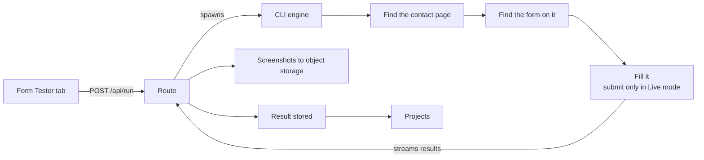
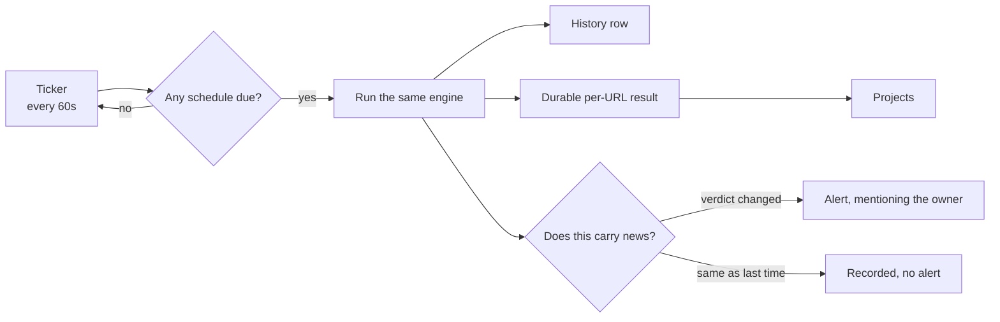
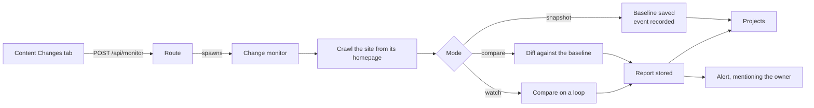

# How FormPing works

The detail behind the [README](../README.md): how the engine finds, fills and submits forms, how results and alerts are worded, how failures are handled, how the workspace is split between people, and how each kind of run moves through the app.

## Contents

- [The web app](#the-web-app)
- [Form testing](#form-testing)
- [Your own workspace, one shared record](#your-own-workspace-one-shared-record)
- [How a run flows](#how-a-run-flows)

---

## The web app

The app is organized around **Projects** (a client and their URLs), with two tool areas — **Contact Forms** and **Site Health** — plus Team and Docs.

| Area | What it is |
|------|------------|
| **Projects** | A client and their URLs. The shared record: every project, URL and result is visible to the whole team. A URL tested or monitored but not yet grouped lands in an **Unassigned** bucket rather than nowhere. |
| **Contact Forms** | Two surfaces over one engine. The **Form Tester** runs it on demand and reports every form on the site; the **Form Scheduler** runs it on a cadence and reports one form on one page. Same engine, different scope and different storage. |
| **Site Health** | **Uptime & SSL** — availability, certificate and domain expiry, on its own ticker. **Content Changes** — page snapshots diffed over time, host-level rather than per URL, with an optional AI summary of each diff. |
| **Status pages** | A token-addressed, client-safe projection of a project's health, served without auth. The internal view is the same builder with `internal: true`, which is the only thing that populates the technical detail. |

---

## Form testing

Point the engine at a URL and it does what a careful person would: find the forms, work out what each one is for, fill the ones that capture leads, and — in Live mode — actually send one and watch what the site does with it. Then it reports what happened, in plain language, with a picture of what it matched.

### 1. Finding the forms

By default a run covers the **whole site** — that is the Form Tester's job, and a scheduled monitor is the deliberate exception, resolving its page once and checking that page from then on (see *A scheduled check* below). It discovers the contact page using deterministic heuristics (path matching + anchor-text scoring), and when a site doesn't use a conventional contact slug, a **content-driven fallback** scans the homepage, navigation and sitemap — rendering pages in a real browser when the site is JavaScript-heavy or blocks lightweight fetches — and picks the page that actually holds a contact form, **including one hidden inside a multi-step widget**. The form is found regardless of the page's URL or how it's built.

Alongside that, the engine **inventories every other reachable page** and records **every** form it finds, each with its own live source URL. Only forms a visitor can actually see are reported — a hidden modal copy of a form is not listed as a second form — and a third-party form counts only when its embed is really on the page: a provider's tracking script on its own is evidence the site uses that vendor, not that a form is embedded. Each is classified — **contact, newsletter, search, login, or another lead form** such as a rental or demo request — so the report can say what a form is *for*, not just that one exists. A form that repeats across the site (a header search, a footer newsletter) is recognised as the same form, shown once, and marked **global**.

**A hosted form is not hidden by a footer sign-up.** When the only native form on a page is a newsletter, search or sign-in box and a recognised embed (HubSpot, Typeform, Jotform, Tally, Calendly) sits on that same page, the embed is what the page is offering, and it is what gets reported. A footer sign-up appears on every page of most sites, so treating it as proof that a contact form is absent is how a plainly visible hosted form came to be reported as none at all. A native contact form still wins where one exists — it can actually be filled and submitted, and an embed cannot.

**A sign-in form is never the contact form** — at any score, in any mode. A form that posts to an auth route, carries a password field, or is titled "Log in" / "Sign up" / "Reset your password" is dropped before scoring begins, so it can neither win discovery nor be tested. It is still *inventoried* as a login form, because knowing the site has one is useful; it is just never the form under test.

For each form it reports the source page, native vs third-party embed (and which provider, iframe vs script), field count and names, single- vs multi-step, whether **that form** carries a CAPTCHA, and any hidden **UTM / click-id tracking** it captures — or flags a lead form that captures none, since those leads won't carry a campaign source.

**Honeypots don't count as fields.** A decoy input planted to catch bots (`_gotcha` and friends — hidden from view, named to be recognisable) is left out of the field list, the count and the labels. A decoy is identified by being both out of sight *and* named like a trap, so a genuine field inside an unopened wizard step is never mistaken for one, and the legitimate hidden inputs that carry UTM values are still reported.

### 2. Filling them

**Every lead form gets filled** with configurable test data — not just the main contact form. Search, newsletter and login inputs are recognised as utility forms and left untouched.

**A wizard is recognised before anything is filled.** A Next or Continue control is what makes a form multi-step, and that is read straight from the page — so a Detect run, which never fills, still reports the form's shape rather than guessing at it. Where nothing established the shape, nothing is claimed either way.

**Multi-step wizards are walked**, step by step (fill → Next → fill) until the submit control is reached — whichever shape the wizard takes. The steps may sit inside one `<form>`, outside it in a surrounding container, or in a **separate `<form>` per panel**; the walk follows the panel that is actually on screen rather than assuming the one it started in. Every step's fields are filled, counted once across the whole form, and reported with the labels they carry on the page.

The run reports what the walk DID, never what the form contains. Reaching a submit control is the end of the fillable sequence, not necessarily the end of the form: a wizard can reveal a further panel only once it has been sent, and a run that does not submit cannot count it. So a card reads "walked 3 steps", or "reached step 2" where the walk stopped early — a description of the run rather than a claim about the form.

**Whether a form has steps is decided before anything touches it.** The probe locates a form by its position in document order, so its answer is only meaningful while the page is as it was when that position was taken — filling a wizard moves the page out from under it. Asking first is what keeps one form from having two verdicts depending on the mode that looked at it.

**A lead form found during the site crawl is walked like any other**, and reports what the walk learned: the steps it traversed, the fields it saw across all of them, and a screenshot of each. A wizard's field count is what the whole walk saw, not the one panel visible when it was found — "2 fields" on a three-step form is a true number answering the wrong question.

**Per-step screenshots are a Form Tester feature.** Each costs an image and a moment on a run that already takes 30–90 seconds, so a scheduled monitor keeps its single shot: paying for a set on every check, forever, buys evidence nobody opens until something breaks. A single-step form produces none — one step is not a sequence, and the form's own screenshot already shows it.

What any of this can show depends on the mode. Detect fills nothing, so it sees the first step and no further: a wizard does not advance until its required fields are completed. Safe walks and photographs every step up to the send control. Live reaches whatever lies beyond it, being the only mode that submits.

### 3. Submitting — Live mode only

In Live mode the primary contact form is submitted and the engine watches for a thank-you redirect or an inline success message. Every other lead form is filled but **not** sent; each can be submitted on demand from its own panel, behind a confirmation.

Two deliberate brakes: a multi-step form is submitted **only if the run cleanly reached the final step and filled an email**, so a partial walk never drops a junk entry into someone's inbox — and CAPTCHA or anti-bot protection is **never bypassed**. If one is hit, the run stops and says so.

### 4. Evidence for what it matched

Every matched form is **photographed** — the form *and the heading above it*, since "Request a demo" is what identifies a form and a picture of bare input boxes doesn't. Cookie banners, chat bubbles and sticky headers are hidden for the shot, so the evidence is the form rather than whatever was floating over it. The form's address carries its anchor where the page provides one, so the link opens scrolled to the form.

The images are stored server-side and fetched lazily, per form, so they never slow a run down or inflate what the browser holds. Each one is captured **before** anything is filled in, so a screenshot never contains test data, and its URL carries a random component so it can't be guessed from a site's address. Re-testing a URL replaces its screenshots rather than adding to them, and deleting the URL or its project deletes them too.

### 5. Saying when it isn't sure

A weak match is reported as a weak match. If the only form on a page has a single input, the engine **stops rather than filling it** and asks whether that's really your contact form — that shape is a search box or an email sign-up far more often than a way to reach you. A form accepted only because Landing-page mode asserted it's on this page is still tested, but presented as *detected*, never as a confident green pass.

Counts and claims are scoped to the form itself: a **CAPTCHA is only reported on the form carrying the widget** (bot-protection code elsewhere on the page is described as exactly that), and a site-wide search input swept in with a form is **listed but not counted**, so the field count matches the form in front of you.

### Test modes

| Mode | Behavior |
|------|----------|
| `detect-only` | Find the contact page and form; don't fill or submit. |
| `safe` | Find the page and form, fill the fields — **never submit**. |
| `live` | The full flow **including submission** — only on sites you're authorized to test. |

The **app** defaults to `detect-only` in both the Form Tester and the Form Scheduler: the out-of-the-box behaviour puts nothing into a stranger's form, and Safe and Live are deliberate choices. The **CLI** still defaults to `safe` (`--mode`), since it's invoked explicitly and scripts depend on that behaviour.

**Landing-page mode** skips discovery and the site crawl, testing the form on the exact URL given — for standalone landing pages with an inline form and no separate `/contact` page. Detection is also more lenient there: since you've asserted the form is on this page, the best-scoring form is accepted even if it wouldn't clear the usual contact-form threshold (a quiz, assessment or booking form is still a real form) — and the result says plainly that it's a low-confidence match.

**A pinned page** (`--target-page`) also skips discovery and the crawl, and is otherwise nothing like landing-page mode. It exists for the Form Scheduler, where a monitor watches one form on one page: the page is resolved once and then loaded directly on every later check. Because the page was resolved rather than asserted, detection stays **strict** — borrowing landing-page leniency would let a monitor settle on a newsletter box — and the run reports no contact-page confidence, since no discovery ran; the confidence that chose the page belongs to the run that resolved it.

Leniency lowers the *threshold*, not the standard. A form a visitor can see always beats one they cannot, so a hidden form is accepted only when it is the page's **only** candidate — the hidden multi-step wizard that leniency exists for.

### When a form isn't submitted, the result says *why*

- **`FORM_NOT_FOUND`** — genuinely nothing: no native form and no known embed.
- **`NON_CONTACT_FORM_FOUND`** — a form exists but isn't a contact form. The result names what it actually is (a search box, a newsletter sign-up) and shows the screenshot.
- **`LOW_CONFIDENCE_FORM`** — the only match was a single-input form, which reads like a search box or an email sign-up. Nothing was filled; the screenshot is shown so you can confirm or rule it out.
- **`SERVER_ERROR`** — the form was filled and submitted, and the site's *own* endpoint answered with a 5xx. The form isn't misconfigured and the data wasn't rejected: the code behind it crashed, so every real enquiry is being lost too. Reported ahead of any error text on the page, because a status code is evidence where page text is a guess.
- **`THIRD_PARTY_EMBED_FORM`** — a hosted embed (Typeform, HubSpot, Calendly, Jotform, Tally, and similar) is present. It's detected and named so you can verify it by hand, even though it can't be auto-filled across origins.
- **`MULTI_STEP_FORM_DETECTED`** — a multi-step ("Next"-style wizard) contact form was found but couldn't be filled this run (its steps/fields weren't reachable). Detected, not broken. When the wizard *can* be walked, the run reports `SAFE_MODE_NO_SUBMIT` (safe) or a submit outcome (live) instead.
- **`SUBMIT_HELD_INCOMPLETE`** — a multi-step form was filled through its steps, but the Live submission was deliberately held because the run didn't cleanly reach the final step or fill an email.

The same facts, in the same words, appear on the Form Tester result card, each Form Scheduler run, and the per-URL dashboard — one engine, one story. A scheduled check records the same detail about the form it tested as a manual test does, so watching a URL makes its dashboard richer; when a URL has both, the page shows the more recent one and says which it was. The one thing only a manual test carries is the **whole-site inventory**, because searching the site is what the Tester does and a monitor watches a single page.

### Notifications carry what the run found, and link to where the rest is

A Slack message is a ping, not the record — incoming webhooks throttle, and a message nobody reads is no better than one that says nothing. So an alert carries a short `facts` line built from the run itself: the embed provider behind a third-party form, the field count, the page it was found on, how many forms share that page, whether a CAPTCHA is present, and the engine's own hedge when it wasn't confident. Most useful first, capped at five facts and ~240 characters, trimmed by whole facts rather than mid-phrase.

Every alert — Form Watch, Site Watch and the Change Monitor — is assembled the same way: `facts` for what was found, `scope` for what was looked at, and `action` for what a person must still do by hand *and why it could not be done automatically*.

Every claim in those lines is read from the run, never from its configuration. A mode says what a check is *for*; only the result says what it *did*. So the sentence comes from `submissionResult` and the reason code — "submitted and confirmed", "submitted, but no confirmation was seen", "filled, but the submission did NOT go through", "could not be filled" — with the mode as context. `runOutcome()` derives it in one place, and a test walks every mode against every outcome the engine emits. Scope matters as much as facts: a whole-site form search reports the form it judged to be the main one, an uptime check covers one URL and not the pages behind it, and a change report compares only the watched pages. Each of those results is easy to over-read, so each states its own limits.

Severity is about how a result should READ, not merely how bad it is. There are four: `critical`, `warning`, `notice` and `info`, matched to the app's own `--fp-danger` / `--fp-warn` / `--fp-info` / `--fp-ok` tokens so a Slack message and a card never disagree. `notice` covers the middle ground: a recognised third-party form is not a success — nothing was submitted — and not a fault either, so it wears neither a green tick nor a red bar. The "needs a manual check" line carries the warning instead, and always states the reason.

Amber is reserved for one meaning: a person should look, because the form may be broken. A check the engine could not complete says so in its own words instead — a CAPTCHA, an anti-bot challenge, a host firewall, a wizard whose steps could not be walked, or a page whose only form isn't a contact form. Those describe our limits or the site's own defences, not a fault its owner should act on, so they read as **not tested** rather than **needs attention**. That distinction is made once, where the verdict is decided, so the monitor card, the Form Tester, the project rows and Slack cannot disagree about the same run.

When the failure is **ours**, the alert says so. If the outbound proxy refuses to forward a submission, the request never reaches the site and nothing is learned about the form — so that is never reported as the form failing. It is raised as an infrastructure alert instead: loud, because while it lasts every submission check is testing nothing, but aimed at the monitoring rather than at the monitored site. One alert per outage however many monitors hit it, repeated each window until it clears.

**A monitor reports change, not state.** A run is announced when it carries news: the first check of a schedule, a change of verdict, a change in the form itself (a field added, a CAPTCHA appearing, a rewritten action URL), or a spaced reminder that a broken form is still broken. A verdict that simply repeats stays quiet — a permanent fact about a site, arriving every cycle forever, is how a channel earns its mute, and a muted channel swallows the one alert that mattered. Nothing suppresses a change; the suppression applies to repetition only, every run is still recorded either way, and the standing state stays on the monitor card where it is there when someone looks.

**An alert names the person it is for.** Every monitor records the email of whoever created it, and the alert @mentions them in the shared channel — so it reaches a person rather than a channel in which everyone assumes somebody else is handling it. The channel still sees everything; the mention only decides whose attention it asks for.

Turning an email into a Slack mention needs a user id, which only Slack can supply, so the id is resolved once and cached. That cache does more than save a request: a cached id keeps mentioning correctly while the token is revoked or Slack is unreachable, which is exactly when something else is likely to be wrong too. Where no mention can be built — a monitor nobody owns, no bot token configured, an address Slack has never seen, someone who left the channel — the alert posts exactly as it always has. An alert that arrives unmentioned is a small loss; an alert that does not arrive because a mention could not be built is the failure the feature exists to prevent.

**Every message carries a notification line.** Slack shows only a payload's top-level `text` in OS notifications and unopened previews, so one built from blocks alone renders "[no preview available]" — a notification that says something arrived and nothing about what, which on a phone is the whole message. Both senders, alerts and bug reports, build that line from their own content, and a test asserts it on each: the rule is about the shape of what we send, so a new sender is covered the moment it is added there.

Internal identifiers never appear. A reason code like `THIRD_PARTY_EMBED_FORM` is an internal enum; the verdict label already says it in English.

The "See the full detail" link resolves to the per-URL dashboard, built with the same `matchKey` + `encodeUrlKey` pair the app's own links use, so the two cannot drift. A unit test walks every path the builder can emit against the actual route files under `ui/src/app`, so a link can only be emitted for a route that exists.

### A failed check explains itself, and retries at a sensible interval

When a check can't produce an answer, the reason is carried as a *kind* — `unreachable`, `rate_limited`, `not_published`, and so on — from the moment it happens. The raw message (`fetch failed`, a TLS socket error, an RDAP status) stays on the result for the server log, and no user surface renders it: the dashboard, the monitor card and the Slack alert all phrase the kind instead.

A 2xx/3xx answer is not taken as proof the site works. The uptime check also reads the page, and a short page carrying a known failure screen — a WordPress database or critical error, a PHP fatal error, a suspended hosting account, or a parked domain — is reported as down with the kind `broken_page`. The markers live in `ui/src/lib/siteWatch/brokenPage.ts` and only count on a page under 30,000 characters, so a full page that merely quotes one of the phrases stays up.

That distinction also drives the retry. A domain expiry is re-read at most every 12 hours, because it changes once a year and public RDAP endpoints rate-limit. But a registry that was briefly unreachable is asked again in 30 minutes, while a registry that doesn't publish expiry dates at all — true of many country domains — keeps the long interval, since asking twice can't make the field appear. A transient failure also keeps showing the expiry we already know, marked as not refreshed, rather than replacing a good answer with an error.

### A result that couldn't be stored is reported, not painted over

A monitor's run record and the summary on its card are separate writes to separate tables. If the run record is refused — a schema mismatch, a database blip — the summary must not be written anyway, or the card reports a fresh healthy check above a history that doesn't contain it.

So writes are sorted into two kinds. **Essential** writes (the run record, the durable per-URL result, the daily rollup behind the uptime figures) report whether they landed; a failure is logged at `error` level and the monitor keeps the last result it can actually prove, advancing only its retry time. The card then says *"The last check could not be saved"* rather than showing stale figures as current. **Best-effort** writes (screenshots, Slack posts, the activity log, history pruning) still fail quietly on purpose, and say so where that choice is made.

On boot a schema guard selects the columns each critical table is expected to have and logs a loud, unmissable error if any are missing, so a schema drift is visible immediately rather than inferred later from wrong figures. It never stops the server: a monitoring tool that refuses to start is worse than one running with a stale column.

---

## Your own workspace, one shared record

A role says what you may do. Separately, the app splits into two planes that decide what you **see**.

The four tool tabs — Form Tester, Form Scheduler, Uptime & SSL, Content Changes — are **yours**. Your runs, your monitors, their logs and their in-flight state are stamped with your address when you create them, and nobody else's work appears on your screen. Ten people can use the app at once without wading through each other's output.

**Projects is the shared record.** Every project, every URL and every result is visible to the whole team whoever produced it — that is the point of it. A project names who created it and who last edited it, and a URL names **who watches it**, because a page is monitored by one person and knowing who is how you find the right person to speak to.

Those two rules meet at a URL: **one page, one monitor, one owner.** The duplicate check is deliberately global rather than per-user, so a second monitor can never be created for a page somebody already watches — two monitors on one form would mean two real submissions landing in the client's inbox every cycle, each invisible to the other. When that refusal happens it names the owner, since an obstacle you cannot see and nobody is named for is a dead end.

Alerts follow the same column: a failing check mentions whoever set the monitor up, so the person responsible hears about it rather than everybody hearing about everything.

**A monitor can be handed on.** Somebody goes on leave and a client's form is suddenly watched by a person nobody can reach — nobody else can pause it, re-point it or stop it, and its alerts land in an inbox nobody is reading. So a monitor can be reassigned from Projects: an admin may move anyone's, and you may always hand on your own. The alternative, letting admins read everybody's tool tabs, was rejected — it makes isolation conditional for everyone, permanently, to solve something that happens occasionally.

The handover is a single write. `owner` moves, and alert routing follows it without being told. **No run or result is touched**: a stored check records who was responsible when it happened, and rewriting that would make the log claim somebody performed work they never did. The new owner still sees the whole history, because access to a monitor's runs follows the schedule rather than the rows. Content-change tracking is the exception — it has no schedule, so its ownership is a property of each run and there is nothing to hand over.

Isolation is behind a flag, read per request, and defaults to off — with it off the app behaves exactly as it did before, which is also what keeps a local checkout with no sign-in working.

---

## How a run flows

Three paths through the app, each expanded below. They share the same engine and the same stores — what differs is who starts a run and what happens to the result.

<strong>A form test, start to finish</strong> — the Form Tester

The route spawns the engine as a child process and streams its output back to the browser, so a long run reports progress rather than finishing in silence. Each result passes through a step that swaps the engine's inline screenshots for hosted URLs, which is why the heavy bytes stop at the server and never reach the browser.

The tab itself keeps what you see in the browser; the stored result is what Projects reads. That is why clearing the tab does not remove anything from Projects.

<strong>A scheduled check</strong> — Form Scheduler and Uptime &amp; SSL

The ticker runs on its own timer with nobody signed in, so it reads every schedule regardless of who created it. A run inherits its owner from the schedule that triggered it, which is how a scheduled failure reaches the person who asked for the check.

Two rows are written per run and they answer different questions: the history row is what happened on this check, the durable per-URL result is the latest state of that URL. The second survives the monitor being stopped, which is why Projects still shows a result for a URL nobody is watching any more.

**A run started by a person takes the identical engine path and writes only the history row.** That identity is the point — a check somebody triggers must never be able to drift from what the monitor actually does — but it reschedules nothing, fires no alert, updates no durable result and uses its own screenshot folder, so asking a question about a URL cannot cost the schedule that answers it. `trigger_source` is what distinguishes the two, and those rows are swept after a day: a one-off answer is not part of the record a schedule is building.

A form monitor watches **one form on one page**, and resolves that page once. Its first check discovers the contact page as a manual test would — or starts from a stored Form Tester run for the same URL, which already knows it — and the page is then written onto the schedule. Every later check loads it directly, so a monitor no longer re-crawls a client's site on a timer to report on a single form. A monitor with no page recorded yet simply discovers again, which is how the ones created before this behave until their next check pins them; they cannot change which form they watch as a result of it.

The page moves only when somebody presses **Find the form again**, which clears it and lets the next check resolve it afresh. When a pinned check stops finding its form, and only on that transition, one detect-only discovery pass runs to report where the form appears to have moved — the monitor says so rather than re-pointing itself, since a monitor that silently redefines what it watches is the problem this avoids.

An alert is sent when the run carries news — a first check, a changed verdict, a change in the form itself, or a spaced reminder that a problem persists.

<strong>A content-change run</strong> — snapshot, compare, watch

Tracking is per hostname rather than per URL, because the monitor crawls a whole site from its homepage. URLs sharing a host therefore share their change history.

A snapshot writes no report — there is nothing to compare yet — so it records an event instead. That event is what lets Projects show a freshly baselined URL as tracked rather than untouched.

A watch outlives the request that started it. The server re-spawns active watches when it restarts, recovering each one's settings and owner from disk, since that path has no signed-in user to ask.

